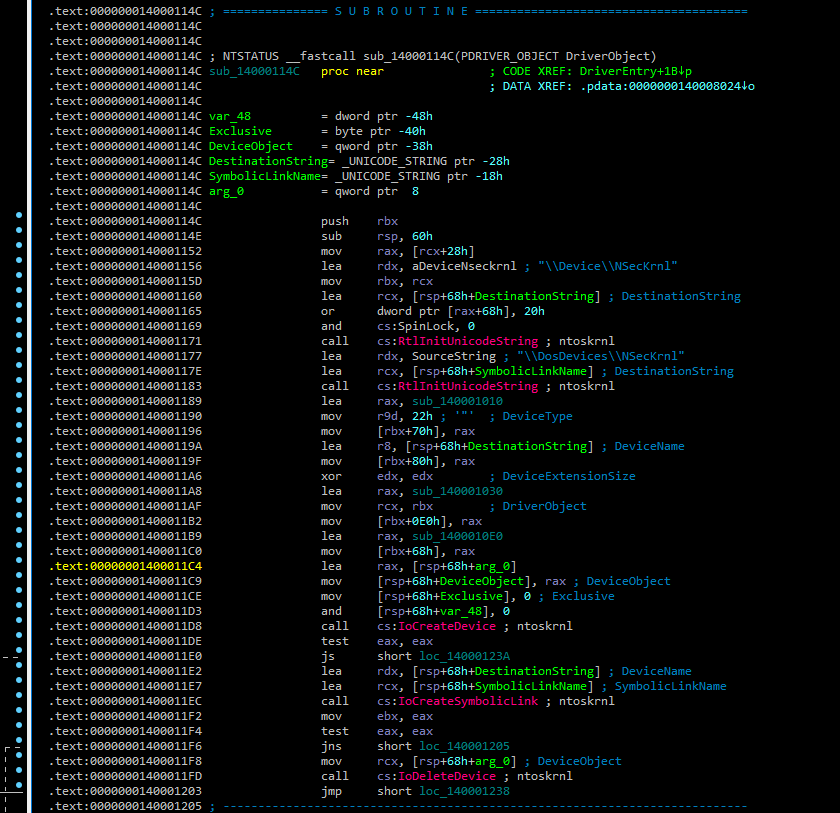

# Kernel Shield — Windows Kernel Driver Analysis


**Malops.io CTF Writeup**

`Category: Malware Analysis / Reverse Engineering`  `Target: Windows Kernel-Mode Driver (x64)`  `Tool: IDA Pro`

**Author Name:** Shantanu Umrani

---

## Scenario

Your organization's incident response team has been called in after a devastating ransomware attack encrypted critical servers across the network. During forensic analysis, the team discovered that the ransomware didn't just encrypt files — it first deployed a malicious kernel driver named 'NSecKrnl' to neutralize all endpoint detection and response (EDR) solutions running on the target machines. By operating at the kernel level, the driver was able to intercept process handle operations, strip security tool access rights, and forcefully terminate any protective processes before the ransomware payload executed. Without EDR visibility, the ransomware operated completely undetected. Your task as a malware analyst is to load this kernel driver into IDA Pro and fully reverse engineer its capabilities. Uncover how it initializes, how it evades kernel integrity checks, how it communicates with its usermode ransomware component via IOCTL codes, and how it systematically kills EDR processes. Your findings will be critical to understanding the full attack chain and building detections to prevent future incidents.

---

## Overview

**Methodology:** 100% static analysis (no dynamic execution / debugging). Every answer below is backed by decompiled pseudocode and/or a disassembly screenshot captured directly from IDA.

---

## Table of Contents

1. [Qs1: Device Name Exposed to Usermode](#qs1-device-name-exposed-to-usermode)
2. [Qs2: Loader Entry Flag Value Set by the Driver](#qs2-loader-entry-flag-value-set-by-the-driver)
3. [Qs3: Byte Offset of the Tampered Loader Entry Field](#qs3-byte-offset-of-the-tampered-loader-entry-field)
4. [Qs4: IOCTL Code for Forced Process Termination](#qs4-ioctl-code-for-forced-process-termination)

---

## Quick Reference — Answer Key

| # | Question | Answer |
|---|---|---|
| Qs1 | Name the driver exposes to usermode | `NSecKrnl` |
| Qs2 | Hex value OR'd into the loader entry field | `0x20` |
| Qs3 | Byte offset of the tampered field | `0x68` |
| Qs4 | IOCTL code leading to forced process termination | `0x2248E0` |

---

## Qs1: Device Name Exposed to Usermode

> **Question:** The driver exposes itself to usermode applications under a specific name. What is this name?

**Answer:**

```text
NSecKrnl
```

**Finding:** `DriverEntry` only initializes the security cookie and calls `sub_14000114C`. That routine creates the device `\Device\NSecKrnl` with `IoCreateDevice()` and the symbolic link `\DosDevices\NSecKrnl` with `IoCreateSymbolicLink()`. The symbolic link is what user mode opens, as `\\.\NSecKrnl`.

It also sets `IRP_MJ_CREATE` / `IRP_MJ_CLOSE` to `sub_140001010`, `IRP_MJ_DEVICE_CONTROL` to `sub_140001030` (the IOCTL dispatcher, see [Qs4](#qs4-ioctl-code-for-forced-process-termination)), and registers process-creation and image-load notify routines.

<details>
<summary>Step 1 — DriverEntry</summary>

```c
NTSTATUS __stdcall DriverEntry(PDRIVER_OBJECT DriverObject, PUNICODE_STRING RegistryPath)
{
  _security_init_cookie();
  return sub_14000114C(DriverObject);
}
```

</details>

<details>
<summary>Step 2 — Real initialization routine (sub_14000114C)</summary>

```c
NTSTATUS __fastcall sub_14000114C(PDRIVER_OBJECT DriverObject)
{
  NTSTATUS result; // eax
  NTSTATUS v3; // ebx
  struct _UNICODE_STRING DestinationString; // [rsp+40h] [rbp-28h] BYREF
  struct _UNICODE_STRING SymbolicLinkName; // [rsp+50h] [rbp-18h] BYREF
  PDEVICE_OBJECT DeviceObject; // [rsp+70h] [rbp+8h] BYREF

  *((_DWORD *)DriverObject->DriverSection + 26) |= 0x20u;
  SpinLock = 0;
  RtlInitUnicodeString(&DestinationString, SourceString: L"\\Device\\NSecKrnl");
  RtlInitUnicodeString(DestinationString: &SymbolicLinkName, SourceString: L"\\DosDevices\\NSecKrnl");
  DriverObject->MajorFunction[0] = (PDRIVER_DISPATCH)&sub_140001010;
  DriverObject->MajorFunction[2] = (PDRIVER_DISPATCH)&sub_140001010;
  DriverObject->MajorFunction[14] = (PDRIVER_DISPATCH)&sub_140001030;
  DriverObject->DriverUnload = (PDRIVER_UNLOAD)sub_1400010E0;
  result = IoCreateDevice(
             DriverObject,
             DeviceExtensionSize: 0,
             DeviceName: &DestinationString,
             DeviceType: 0x22u,
             DeviceCharacteristics: 0,
             Exclusive: 0,
             &DeviceObject);
  if ( result >= 0 )
  {
    v3 = IoCreateSymbolicLink(&SymbolicLinkName, DeviceName: &DestinationString);
    if ( v3 >= 0 )
    {
      byte_140003010 = PsSetCreateProcessNotifyRoutine(NotifyRoutine: NotifyRoutine, Remove: 0) >= 0;
      byte_140003011 = PsSetLoadImageNotifyRoutine(NotifyRoutine: guard_check_icall_nop) >= 0;
      sub_140001518();
    }
    else
    {
      IoDeleteDevice(DeviceObject);
    }
    return v3;
  }
  return result;
}
```

</details>

<details>
<summary>Disassembly View</summary>



</details>

---

## Qs2: Loader Entry Flag Value Set by the Driver

> **Question:** During initialization, the driver tampers with its own loader entry to bypass a kernel security check. What hex value is OR'd into that field?

**Answer:**

```text
0x20
```

**Finding:** The first statement in `sub_14000114C` patches the driver's own loader entry:

```c
*((_DWORD *)DriverObject->DriverSection + 26) |= 0x20u;
```

`DriverSection` points to the driver's `KLDR_DATA_TABLE_ENTRY`. The statement sets bit `0x20` in its `Flags` field, the integrity-check flag that the kernel's `MmVerifyCallbackFunction` looks for before allowing a driver to register kernel callbacks. The flag is set before the callbacks are registered, so the registrations are not rejected.

<details>
<summary>Disassembly View</summary>


</details>

---

## Qs3: Byte Offset of the Tampered Loader Entry Field

> **Question:** At what byte offset from the base of the loader data table entry does this tampering occur?

**Answer:**

```text
0x68
```

**Finding:** `DriverSection` is cast to `_DWORD *` (4 bytes per element), so the index `+ 26` is a byte offset of:

```text
26 × 4 = 104 = 0x68
```

This matches the x64 `KLDR_DATA_TABLE_ENTRY` layout, where the 32-bit `Flags` field follows `BaseDllName` (`0x58` + `0x10` = `0x68`).

<details>
<summary>Disassembly View</summary>


</details>

---

## Qs4: IOCTL Code for Forced Process Termination

> **Question:** One of the IOCTL codes handled by the dispatch function leads to forced process termination. What is this code in hex?

**Answer:**

```text
0x2248E0
```

**Finding:** `sub_140001030` is the `IRP_MJ_DEVICE_CONTROL` dispatcher. It compares the IOCTL code against four decimal constants and calls a handler for each. (IDA shows the code as `Parameters.Read.ByteOffset.LowPart`; it is really `Parameters.DeviceIoControl.IoControlCode`, and `MasterIrp` is the `SystemBuffer` input buffer.)

| Decimal | Hex | Handler |
|---|---|---|
| `2246868` | `0x2248D4` | `sub_1400012B8` |
| `2246872` | `0x2248D8` | `sub_140001614` |
| `2246876` | `0x2248DC` | `sub_140001240` |
| **`2246880`** | **`0x2248E0`** | **`sub_1400013E8`** (forced process termination) |

Decoded as a `CTL_CODE`, `0x2248E0` is device type `0x22` (matches `IoCreateDevice` in Qs1), function `0x238`, `METHOD_BUFFERED`, `FILE_READ_ACCESS`. Each handler receives the value at the start of the input buffer. A non-zero handler result returns `STATUS_SUCCESS`; otherwise the status stays `0xC0000001` (`STATUS_UNSUCCESSFUL`).

**Conversion — decimal → hex:**

```text
2246880 = 0x2248E0
```

<details>
<summary>Decompiled Pseudocode — IOCTL dispatcher (sub_140001030)</summary>

```c
__int64 __fastcall sub_140001030(__int64 a1, IRP *a2)
{
  void **MasterIrp; // r9
  unsigned int v4; // edi
  char v5; // al

  MasterIrp = (void **)a2->AssociatedIrp.MasterIrp;
  v4 = -1073741823;
  if ( a2->Tail.Overlay.CurrentStackLocation->Parameters.Read.ByteOffset.LowPart == 2246868 )
  {
    if ( MasterIrp != nullptr
      && (unsigned __int8)sub_1400012B8(
                            a1: *MasterIrp,
                            a2,
                            a3: a2->Tail.Overlay.CurrentStackLocation->Parameters.Read.ByteOffset.LowPart - 2246868) != 0 )
    {
      v4 = 0;
    }
  }
  else
  {
    if ( a2->Tail.Overlay.CurrentStackLocation->Parameters.Read.ByteOffset.LowPart == 2246872 )
    {
      if ( MasterIrp == nullptr )
        goto LABEL_16;
      v5 = sub_140001614(
             a1: *MasterIrp,
             a2,
             a3: a2->Tail.Overlay.CurrentStackLocation->Parameters.Read.ByteOffset.LowPart - 2246872);
    }
    else if ( a2->Tail.Overlay.CurrentStackLocation->Parameters.Read.ByteOffset.LowPart == 2246876 )
    {
      if ( MasterIrp == nullptr )
        goto LABEL_16;
      v5 = sub_140001240(
             a1: *MasterIrp,
             a2,
             a3: a2->Tail.Overlay.CurrentStackLocation->Parameters.Read.ByteOffset.LowPart - 2246876);
    }
    else
    {
      if ( a2->Tail.Overlay.CurrentStackLocation->Parameters.Read.ByteOffset.LowPart != 2246880 || MasterIrp == nullptr )
        goto LABEL_16;
      v5 = sub_1400013E8(a1: *MasterIrp);
    }
    if ( v5 != 0 )
      v4 = 0;
  }
LABEL_16:
  a2->IoStatus.Status = v4;
  IofCompleteRequest(Irp: a2, PriorityBoost: 0);
  return v4;
}
```

</details>

<details>
<summary>Tool Usage</summary>


</details>

<details>
<summary>Disassembly View</summary>


</details>

---

## Tools Used

- **IDA Pro** — disassembly, decompilation (Hex-Rays), cross-reference tracing

## Disclaimer

This writeup is for educational and CTF documentation purposes only. All names, identifiers, and values referenced are specific to the Malops.io "Kernel Shield" challenge sample and are not associated with any real infrastructure.
